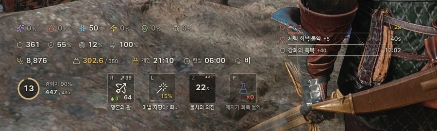

# Tullius Widgets

Skyrim SE용 전투 스탯 HUD 모드. [Prisma UI](https://www.nexusmods.com/skyrimspecialedition/mods/148718) 기반의 현대적인 웹 UI와 항목별 독립 배치를 제공하며, STB Widgets를 대체할 수 있는 확장형 HUD를 목표로 합니다.



<sub>컴팩트 HUD 전투 화면(1080p). 기존 카드형은 [클래식 스타일](docs/design/compact-hud/classic-unchanged-1080p.jpg)로 계속 쓸 수 있습니다.</sub>

## Features

- **컴팩트 HUD (신규 설치 기본값)** — 카드 없이 화면에 녹아드는 왼쪽 아래 계기형 배치. 자원 바(바닐라/TrueHUD/SkyHUD) 위 공간을 비워 두고, 탐험 중에는 생활 정보·장비만, 전투나 값 변화 시 저항·전투 수치가 위로 펼쳐집니다
  - 경험치 링(레벨 + 진행률), 금화·무게·게임/현실 시계·날씨 한 줄, 저항 띠, 방어/치명/이동 줄
  - **장비 슬롯 R / L / Z / P** — 무기·주문 종류 아이콘, 손별 공격력, 마법부여 충전률 바, 무기에 바른 독의 남은 횟수, 활·석궁 화살 수, 포효 재사용 대기시간(남은 초)과 배운/해금 단어, 마지막으로 마신 물약과 남은 개수
  - 지속 효과: 분류 아이콘(체력/속성 저항/방어/투명화 등), 효과 크기, 남은 시간, 해로운 효과 강조, 해로운/이로운 효과만·긴 효과 숨김 필터
  - 금화·경험치 증감(+120 등) 짧은 표시, 원값이 다를 때만 원값 표시, 상한/음수는 색으로 구분
  - 게임 안에서도 같은 모양이 나오도록 폰트(Pretendard, OFL)를 함께 배포
- **클래식 카드 스타일** — 기존 노르딕 카드형 HUD. 업데이트 전부터 쓰던 설정은 자동으로 클래식을 유지하며, 설정 일반 탭에서 언제든 전환 가능. 무기 카드에 충전률·독·탄약 한 줄 표시
- **28개 독립 배치 항목**
  - 성장/플레이어: 경험치 진행도, 레벨, 골드, 소지 무게, 체력, 매지카, 스태미나
  - 저항력: 마법, 화염, 냉기, 전기, 독, 질병
  - 방어: 방어도, 피해 감소율
  - 공격: 오른손/왼손 공격력, 치명타 확률
  - 장착: 오른손, 왼손, 포효/파워, 최근 마신 물약
  - 시간: 스카이림 날짜/시간, 현실 날짜/시간, 날씨, 누적 플레이 시간
  - 이동: 이동 속도
  - 효과: 지속 버프/디버프 목록
- **항목별 표시 조건** — 위젯마다 항상 / 전투 중 / 값이 바뀔 때 / 전투 중 또는 값이 바뀔 때 중 선택
- **컴팩트 묶음 위치 프리셋** — 왼쪽 아래 / 오른쪽 아래 / 왼쪽 위 / 오른쪽 위로 묶음 전체를 한 번에 이동
- **배치 슬롯 3개** — 현재 배치(스타일·위치·크기·표시 여부)를 저장해 두고 언제든 불러오기
- **두 가지 아이콘 스타일** — 대중적인 표준 심볼이 신규 설치 기본값이며, 기존 도로롱 아이콘과 선택형 보조 뱃지도 지원
- **경험치 진행 위젯** — 레벨 마크, 현재/필요 경험치 수치, 가로 진행 막대를 한 위젯에 표시
- **저항 원본/실효 동시 표시** — 저항 이름과 실제 적용 수치, 캡 적용 전 원본 수치를 가로형 위젯에서 구분
- **장착 슬롯 표시** — 오른손/왼손 장비와 선택된 포효/파워 이름 표시, 공격력 위젯과 장비 위젯에 서로 다른 아이콘 사용
- **지속 버프/디버프 리스트** — 주문/포션 소스명 우선 + 효과명 + 남은 시간(초)을 인스턴스 단위로 동적 표시
- **항목별 HUD 편집** — 각 위젯을 독립적으로 이동, 크기 조절, 잠금, 표시/숨김, 앞뒤 순서 변경 가능
- **정밀 배치 도구** — 마우스 드래그와 이웃 위젯 스냅, 방향키 1px 이동, `Shift+방향키` 10px 이동, 정렬 가이드, `Ctrl+Z`/`Ctrl+Y` 되돌리기·다시 실행
- **해상도·화면비 대응** — 4K는 비례 확대, 21:9 울트라와이드에서도 묶음이 가로로 벌어지지 않도록 가까운 화면 가장자리 기준으로 배치
- **주기 동기화(Heartbeat)** — 이벤트가 없는 구간에도 짧은 주기로 스탯을 재동기화해 표기 정지/드리프트를 완화
- **값 변화 기반 표시 모드** — 설정에서 `값 변화 시에만 표시`를 켜면 최근 변경 후 N초 동안만 위젯 표시
- **런타임 진단 경고 배너** — 런타임/SKSE/Address Library 조합 이상 시 게임 내 경고 표시
- **첫 실행 온보딩 카드** — 설정 키/전체 표시 키/표시 모드 핵심 사용법 안내(바꾼 키로 표시)
- **단축키 변경** — 설정 패널 키(기본 Insert)와 전체 표시/숨김 키(기본 F11)를 F1~F12·탐색 키·숫자패드 중에서 지정. 콘솔·글자 입력 중에는 반응하지 않음
- **비네트 시각 알림** — 체력/매지카/스태미나 부족, 과적재 시 화면 가장자리 경고 효과
- **설정 패널** (Insert 키)
  - 선택한 위젯의 표시/숨김, 잠금, 크기, 좌표, 앞뒤 순서와 기본 위치 복원
  - 값 변화 표시 모드 + 표시 유지 시간(초)
  - HUD 스타일(컴팩트/클래식 카드), 전체 투명도와 HUD 폰트 프리셋
  - 장비 이름 표시(항상/바꿀 때만/숨김), 경험치 숫자 표시, 위젯별 표시 조건
  - 표준/도로롱 아이콘 선택과 도로롱 보조 뱃지 설정
  - 저항, 소지 무게, 시간, 지속 효과의 표시 방식
  - 색상 톤 (자동 HUD 감지 or 수동)
  - 배경 투명 모드
  - 프리셋 내보내기/가져오기
- **게임 메뉴 자동 숨김** — 인벤토리, 지도, 제작 등 18종 메뉴 감지
- **외부 JSON 다국어 지원** — 기본 한국어/영어 제공, 추가 언어는 JSON 파일로 확장 가능

## Requirements

- Skyrim SE (1.5.97 / 1.6.x / 1.7.x)
- [SKSE64](https://skse.silverlock.org/)
- [Prisma UI](https://www.nexusmods.com/skyrimspecialedition/mods/148718) (1.7.x는 1.5.0 이상 필요)
- [Address Library for SKSE Plugins](https://www.nexusmods.com/skyrimspecialedition/mods/32444) (1.7.x는 최신 버전 필요)

## Installation

1. [Releases](https://github.com/servaltullius/Tullius-Widgets/releases) 에서 `TulliusWidgets-v*.zip` 다운로드
2. zip 내용물을 `Skyrim Special Edition/Data/` 폴더에 복사
3. 게임 실행

설치 후 폴더 구조:
```
Data/
  SKSE/Plugins/TulliusWidgets.dll
  PrismaUI/views/TulliusWidgets/index.html
  PrismaUI/views/TulliusWidgets/i18n/manifest.json
  PrismaUI/views/TulliusWidgets/i18n/ko.json
  PrismaUI/views/TulliusWidgets/i18n/en.json
  PrismaUI/views/TulliusWidgets/assets/...
```

## Localization

- 기본 번역 파일 위치:
  - `Data/PrismaUI/views/TulliusWidgets/i18n/manifest.json`
  - `Data/PrismaUI/views/TulliusWidgets/i18n/ko.json`
  - `Data/PrismaUI/views/TulliusWidgets/i18n/en.json`
- 새 언어를 추가하려면:
  1. `i18n/<language-code>.json` 파일을 추가합니다. 예: `fr.json`
  2. `manifest.json`의 `defaultLanguage`와 `languages` 배열을 필요에 맞게 갱신합니다.
  3. 게임에서 설정 패널의 `Language` 드롭다운으로 선택합니다.
- 번역 JSON은 평평한 key-value 구조이며, 일부 키가 비어 있으면 기본 영어 문자열로 fallback됩니다.
- 번역 파일이 깨지거나 누락돼도 기본 내장 한국어/영어 번역으로 UI가 계속 동작합니다.

## Controls

| 키 | 동작 |
|----|------|
| `Insert` | 설정 패널 열기/닫기 (설정 → 일반에서 변경 가능) |
| `F11` | 위젯 전체 표시/숨김 (설정 → 일반에서 변경 가능) |
| `ESC` | 설정 패널 닫기 (고정) |
| 클릭 | 설정 패널이 열린 동안 개별 위젯 선택 |
| 드래그 | 선택한 위젯 이동 |
| 우하단 핸들 드래그 | 선택한 위젯 크기 조절 |
| `방향키` | 선택한 위젯 1px 이동 |
| `Shift+방향키` | 선택한 위젯 10px 이동 |
| `Ctrl+Z` / `Ctrl+Y` | 설정 패널이 열린 동안 배치 편집 되돌리기 / 다시 실행 |

## Release Notes Policy

- 릴리즈/프리릴리즈 제목: `Tullius Widgets v<version>`
- ZIP 산출물:
  - 기본(권장, CI 없이): `TulliusWidgets-v<version>.zip`
  - CI 아티팩트(선택): `TulliusWidgets-v<version>-ci.zip`
- ZIP 루트 구조: `SKSE/Plugins/...` + `PrismaUI/views/TulliusWidgets/...`
- 한국어 패치노트 파일: `docs/release-notes/<version>.ko.md`
- 로컬 릴리즈 스크립트(Windows): `pwsh -File .\scripts\release-local.ps1`
- 로컬 릴리즈 가이드: `docs/local-release.ko.md`
- 필수 섹션:
  - `## 변경 요약`
  - `## 사용자 영향/호환성`
  - `## 설치/업데이트 안내`

## 표시값 기준 (원본/실효 분리)

- 치명타 확률: 런타임 계산 `원본값`을 기반으로 `실효 표시 0% ~ 100%`로 출력
- 저항(마법/화염/냉기/전기/독): `원본값`은 별도 보조 텍스트로 표시, 실효값은 `85%` 상한 기준으로 안내
- 질병 저항: `원본값`/`실효값` 분리, 실효값은 `0% ~ 100%`
- 방어도/피해감소: 피해감소는 게임과 같은 `방어도 × 0.12 + 착용 부위(머리·몸통·손·발·방패)당 3%`로 계산하고 `80%` 캡 적용, 방어도는 부위 보너스를 반영한 `최대 효율 AR` 기준 보조 표기로 안내
- 오른손/왼손 공격력: 표시 안전 범위 `0 ~ 9999`

브릿지 payload 스키마 문서: `docs/stats-payload-schema.md`

## Building from Source

### Requirements
- Windows
  - Visual Studio C++ Build Tools 또는 Visual Studio Community
  - [XMake](https://xmake.io/)
  - PowerShell
- WSL/Linux
  - Node.js 22+, npm
  - `powershell.exe` 사용 가능한 WSL 환경

### 권장 빌드 경로
- 프런트만 확인할 때는 WSL/Linux에서 `view` 기준으로 빌드하면 됩니다.
- DLL까지 포함한 전체 빌드/패키징은 Windows MSVC가 필요합니다.
- WSL에서 저장소를 열고 작업 중이어도 `./scripts/package.sh` 또는 `scripts/release-local.ps1`가 내부적으로 Windows 쪽 빌드를 위임하므로, 별도 수동 복사 없이 현재 worktree에서 실행해도 됩니다.

### Frontend
```bash
cd view
npm install
npm run build
```

### C++ SKSE Plugin (Windows MSVC 필수)
Windows PowerShell 또는 Developer Command Prompt에서 실행:

```powershell
xmake f -p windows -a x64 -m release -y --skyrim_se=true --skyrim_ae=true --skyrim_vr=false
xmake build -y -v
```

WSL에서 개발 중이라면 직접 `xmake`를 WSL 안에서 호출하지 말고, 아래 패키징/검증 스크립트를 사용하는 편이 안전합니다.

### 전체 검증 (권장)
Windows PowerShell:

```powershell
pwsh -File .\scripts\verify-runtime-windows.ps1
```

이 스크립트는 다음을 한 번에 확인합니다.
- 프런트 lint/build
- Windows MSVC 네이티브 빌드
- WSL UNC worktree 사용 시 임시 Windows 스테이징 경로를 통한 빌드

### Packaging
Windows PowerShell:

```powershell
pwsh -File .\scripts\release-local.ps1 -NoPublish
```

WSL/Linux:

```bash
./scripts/package.sh
```

동작 방식:
- WSL에서 `./scripts/package.sh` 실행 시 프런트는 WSL에서 빌드
- 네이티브 DLL과 zip 패키징은 Windows `release-local.ps1`로 위임
- 결과물: `TulliusWidgets-v<version>.zip`
- GitHub 게시 시 WSL UNC worktree에서는 WSL `gh`를 우선 사용하고, 일반 Windows 경로에서는 로컬 `gh` 결과를 명시적으로 판정해 릴리즈 존재 확인과 업로드를 진행

### 검증 스크립트 참고
Windows 검증 스크립트:

```powershell
pwsh -File .\scripts\verify-runtime-windows.ps1
```

- Windows PowerShell에서 실행하는 검증 진입점입니다.
- WSL UNC worktree에서 호출해도 필요한 frontend/plugin 빌드는 임시 로컬 경로로 스테이징해서 실행합니다.

### Optional pre-commit hook
로컬 커밋 전에 저장소 기준의 경량 검증을 자동으로 돌리고 싶다면 아래 명령으로 훅을 설치합니다.

```bash
python3 scripts/install_hooks.py --force
```

현재 훅이 수행하는 작업:
- staged `view/` 변경이 있으면 `view`에서 `npm run lint`
- staged Python 파일이 있으면 `py_compile`
- staged PowerShell 파일이 있으면 문법 파싱

### 값 이상치 트러블슈팅
- 치명타 확률이 `100%` 초과, 저항이 `85%` 초과로 보이면 구버전 DLL일 가능성이 큽니다.
- 최신 빌드는 내부 계산 후 다음 범위로 표시값을 제한합니다.
  - 치명타 확률: `0 ~ 100`
  - 마법/화염/냉기/전기/독 저항: `-100 ~ 85`
  - 질병 저항: `0 ~ 100`
  - 오른손/왼손 공격력: `0 ~ 9999`
- 로드 직후(또는 새 게임 직후) CTD가 난다면 `v1.1.3-rc.5` 이상으로 업데이트하고, 모드 매니저에서 구버전 `TulliusWidgets.dll` 중복 활성화를 해제하세요.

## Tech Stack

- **C++ SKSE Plugin** — C++23, [CommonLib-NG](https://github.com/CharmedBaryon/CommonLibSSE-NG), XMake
- **Frontend** — React 19, TypeScript, Vite, [lucide-react](https://lucide.dev/)
- **UI Framework** — [Prisma UI](https://www.nexusmods.com/skyrimspecialedition/mods/148718) (WebKit-based DX11 overlay)

## License

MIT
